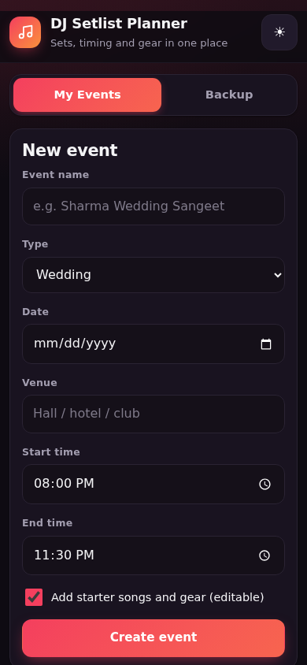
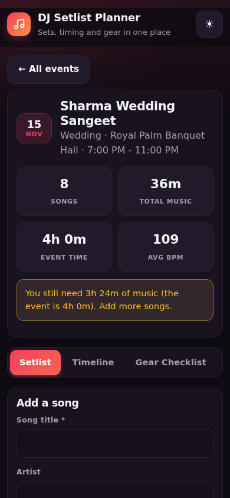
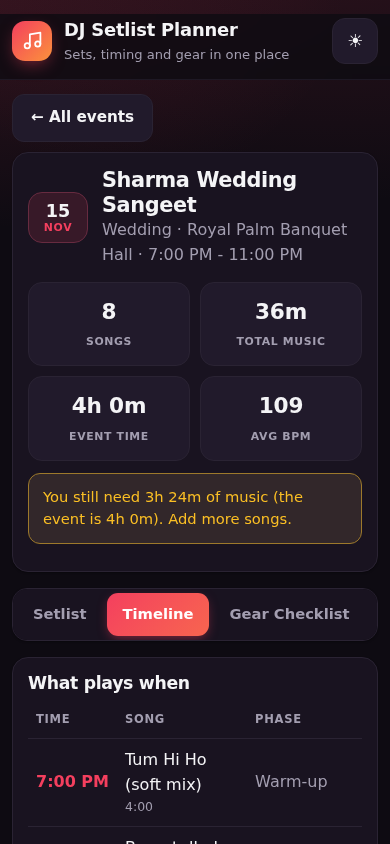
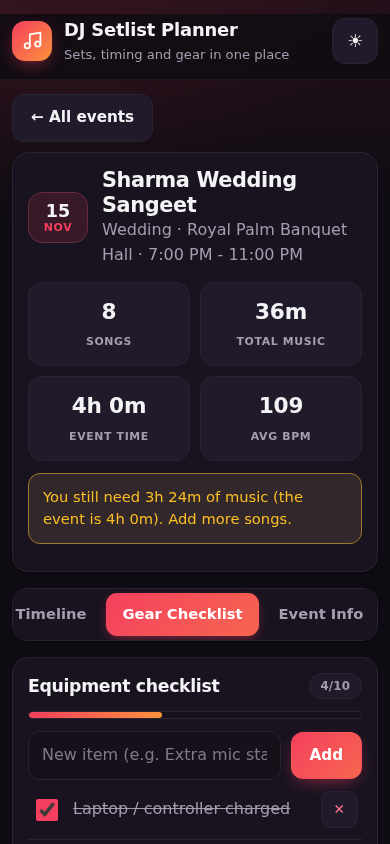
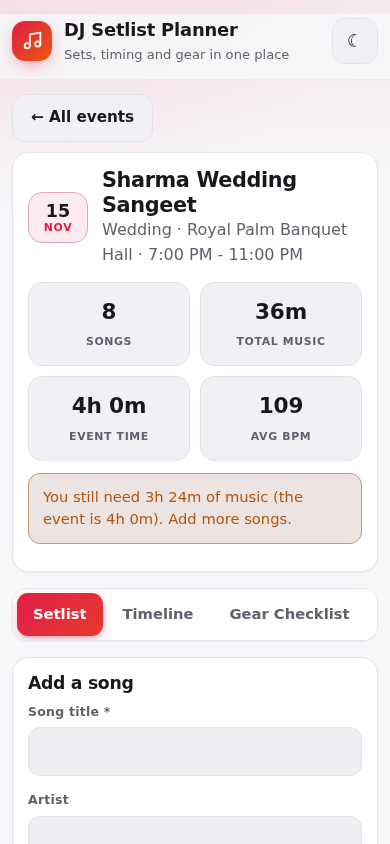
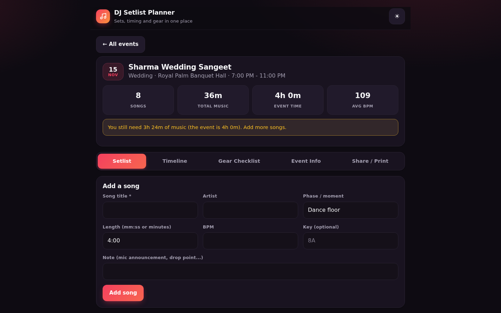

# DJ Setlist + Event Planner

Plan your DJ set - songs, timings, equipment checklist and event details for weddings, birthdays and club nights.

**Live app:** https://akash991833.github.io/dj-setlist-event-planner-app/

Free, no sign-up, no ads. Works in the browser, offline after the first visit, and can be installed on your phone (Chrome menu > Add to Home screen / Install app). Everything is saved on your device only.

## Features

- Multiple events (Wedding, Birthday, Club, Corporate, Other) with date, venue and start/end time
- Setlist builder: song, artist, phase/moment, length, BPM, key and notes; reorder, edit, delete
- Starter setlist and gear list for each event type (all editable)
- Automatic timeline: shows which song plays at what clock time, and warns when the set is too long or too short for the event
- Must-play and do-not-play lists
- Equipment checklist with progress bar
- Share: print / save as PDF, copy text, WhatsApp, .txt download
- Duplicate event, JSON backup and restore
- Dark and light mode, works offline, installable on phone

## How to use

1. Open the app and create an event.
2. Edit the starter songs or add your own in the Setlist tab.
3. Check the Timeline tab to see song start times and the gap against the event end time.
4. Tick items in the Gear checklist before you leave.
5. Use Share / Print to send the plan to the client or keep a PDF.

## Screenshots









## Good to know (limits)

- Data is stored only in your browser (localStorage). Use Backup to move it to another device.
- The starter songs are sample titles with approximate lengths; set your own real lengths and BPM.
- No audio playback or music library connection - this is a planner.

## Run it yourself

No build step. Clone the repo and open `index.html`, or serve the folder with any static server:

```bash
git clone https://github.com/AKASH991833/dj-setlist-event-planner-app.git
cd dj-setlist-event-planner-app
python3 -m http.server 8080
```

Plain HTML, CSS and JavaScript. No tracking, no external requests (fonts, scripts and data are all local).

## Privacy

No account, no server, no analytics. Data stays in your browser's local storage. Clearing browser data deletes it, so use the Backup option if it matters.

## License

MIT
